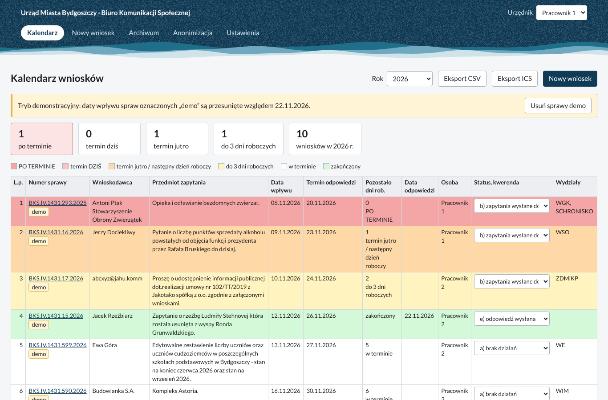

# Asystent UDIP: kalendarz wniosków, projekty pism i anonimizacja dla Urzędu Miasta Bydgoszczy

Aplikacja dla urzędników Biura Komunikacji Społecznej (BKS) UMB, którzy prowadzą wnioski o udostępnienie informacji publicznej. Prowadzi wniosek przez proces z Zarządzenia UMB: wgranie pliku → podobne sprawy i wydział → kalendarz z terminami → odpowiedzi wydziałów → projekt pisma „Ad 1…Ad N” w stylu BKS → anonimizacja z decyzją urzędnika → DOCX do wysyłki i do archiwum. Działa w całości lokalnie, bez internetu. Model językowy jest opcją (lokalny Bielik), a jego wyniki zawsze sprawdzają reguły.

HackNation 2026, wyzwanie „Inteligentny asystent urzędnika” (Urząd Miasta Bydgoszczy). Zespół: [[TEAM]].

- Film (do 3 min): [[WIDEO]]
- Prezentacja: [docs/deck/deck.pptx](docs/deck/deck.pptx), PDF: [docs/deck/deck.pdf](docs/deck/deck.pdf)
- Opis techniczny, wyniki i ograniczenia: [docs/opis_techniczny.md](docs/opis_techniczny.md)



## Dla kogo

- **Pracownik BKS:** rejestr i terminy, pakiety pytań dla wydziałów, projekt pisma, anonimizacja, archiwum.
- **Wydziały merytoryczne:** jasny podział pytań, formularz odpowiedzi, mniej pracy z anonimizacją.
- **Kierownik BKS:** zaległości i terminy na jednym ekranie, historia statusów.

Ten sam proces mają inne jednostki samorządu: zmienia się lista komórek (`udip/data/departments.json`) i szablony pism (`udip/data/letter_types.json`).

## Uruchomienie

**Windows** (wymagany Python 3.11+ i Git; Tesseract tylko do skanów; szczegóły: [docs/INSTALL_WINDOWS.md](docs/INSTALL_WINDOWS.md)):

```powershell
git clone https://github.com/hacknation-2026-solutions/inteligentny-asystent-urzednika
cd inteligentny-asystent-urzednika
powershell -ExecutionPolicy Bypass -File .\setup.ps1
powershell -ExecutionPolicy Bypass -File .\run.ps1
```

**Linux / macOS:** `bash run.sh` (tworzy `.venv`, wczytuje dane UMB, otwiera http://127.0.0.1:8000).

Przy pierwszym starcie aplikacja wczytuje 10 spraw z arkusza UMB z datami przesuniętymi wokół dnia instalacji (tryb demo), żeby kalendarz pokazał wszystkie poziomy pilności. Testy: `bash scripts/smoke.sh` (256 testów, ścieżka end-to-end, scenariusz jury 11/11).

## Ścieżka jury

1. **Kalendarz** (`/kalendarz`): sprawy od najstarszej, kolory pilności, statusy a–e, import arkusza XLSX z raportem niespójności.
2. **Nowy wniosek** (`/wniosek/nowy`): wgraj `data-partner/umb/probki/Wniosek - BKS.IV.1431.599.2026.docx` → 2 pytania, podobna sprawa 307.2025, Wydział Edukacji i Sportu.
3. **Sprawa 543.2026**: pakiety dla wydziałów, potem odpowiedzi z `data-partner/umb/przypadek_543/`.
4. **Projekt pisma**: „Ad 1…Ad 5” z kontrolą liczb („839 psom”, „3.143.761,14 zł”); zdania niepewne czekają na przypisanie.
5. **Anonimizacja**: dowolny plik, np. `demo_assets/02_wniosek_atak_bezpieczenstwa.docx` (ukryty tekst, wstrzyknięte polecenie, PESEL, IBAN, nazwisko ukraińskie). Eksport dopiero po decyzji o każdym fragmencie.
6. **Archiwum**: wysłane pismo w wersji zanonimizowanej trafia do wyszukiwania; panel „Pamięć instytucjonalna” pokazuje, czego aplikacja nauczyła się z poprawek.

Pliki demonstracyjne i opis pułapek: [demo_assets/README.md](demo_assets/README.md).

## Kryteria oceny

| Kryterium (waga) | Co pokazujemy |
|---|---|
| Związek z wyzwaniem (30%) | Proces z Zarządzenia UMB, statusy a–e, znak BKS.IV.1431, styl pism „Ad 1…Ad N”, lista danych do anonimizacji UMB, import obecnego arkusza. Scenariusz jury z treści zadania: 11/11 |
| Kompletność i jakość (30%) | Cała ścieżka od pliku do archiwum działa w aplikacji i ma test end-to-end; 256 testów; instalacja jednym poleceniem |
| Bezpieczeństwo i anonimizacja (20%) | Czułość 100%, precyzja 99%, 0 wycieków na danych testowych; skaner ukrytego tekstu i wstrzykniętych poleceń; eksport zablokowany bez decyzji, kontrola XML i metadanych DOCX; praca offline, dane nie opuszczają urzędu |
| Łatwość obsługi (20%) | Ekrany w języku urzędu, kolory pilności, jeden przycisk na krok, „szary → czarny” jak na papierze; audyt tekstów: [docs/plan/unslop-report.md](docs/plan/unslop-report.md) |

Reguły i lokalny Bielik 4.5B porównaliśmy na danych UMB ($0, offline): [docs/eval/RESULTS.md](docs/eval/RESULTS.md).

## Ujawnienie materiałów i narzędzi AI

- Przed wydarzeniem (21.11.2026) powstał w Claude Code pakiet przygotowawczy: research, skrypty `.claude/skills/udip-*`, dane syntetyczne, archiwum UMB w JSONL ([docs/pakiet_przygotowawczy.md](docs/pakiet_przygotowawczy.md)). Skille `hn-*` pochodzą ze wspólnego pakietu zespołu, skill `unslop-ui` ma licencję MIT.
- Aplikację, testy, skrypty i prezentację zbudował w trakcie wydarzenia Claude Code (Claude Opus 5.5) według [docs/plan/PLAN.md](docs/plan/PLAN.md); zespół zatwierdzał plan, sprawdzał wyniki i nagrał film.
- Dane UMB (`data-partner/umb/`) pochodzą od partnera; dane osobowe w plikach demonstracyjnych są fikcyjne.

## Licencja

Kod przekazywany Miastu Bydgoszcz zgodnie z regulaminem zadania (§ 4). Zależności i dane tylko na licencjach MIT, BSD, Apache-2.0 i 0BSD; font Lato na SIL OFL 1.1, dołączony, żeby działał bez internetu: [LICENSES-THIRD-PARTY.md](LICENSES-THIRD-PARTY.md). Celowo bez PyMuPDF (AGPL), docxtpl (LGPL) i modeli spaCy pl (GPL).
