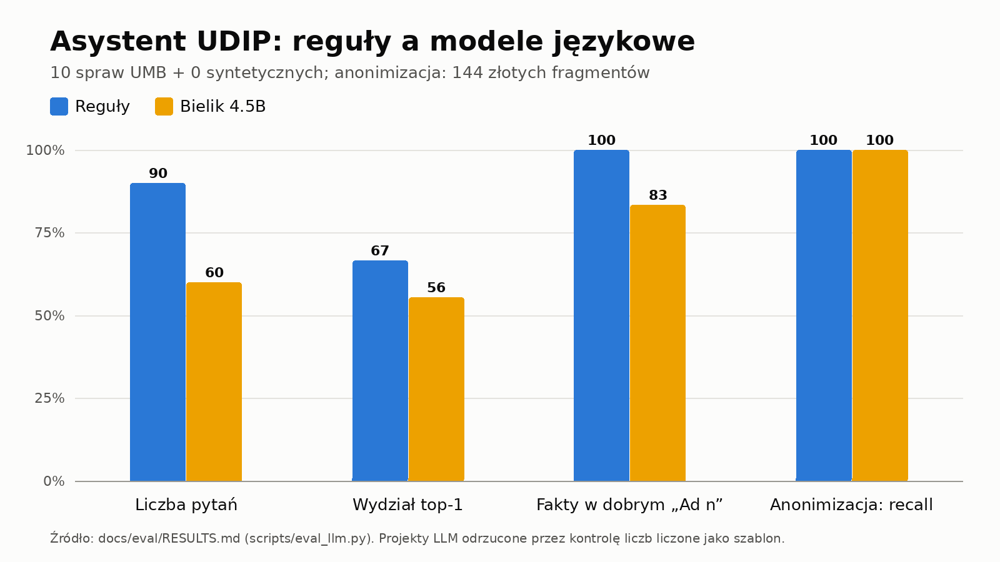

# Ewaluacja: reguły vs Sonnet 5.5 vs Haiku 5.5 (vs Bielik)

Wygenerowano 2026-11-21 skryptem `scripts/eval_llm.py` (tor C, T15). Dane: 10 spraw UMB (`data-partner/umb/`, ręczna złota miara w `docs/eval/umb_gold.json`) + sprawy syntetyczne na wzór UMB (`data-samples/syntetyczne_umb/`), anonimizacja dodatkowo na `data-samples/syntetyczne/pii/`. Szczegóły pozycji: `docs/eval/results/*.json`.

| Miara | Reguły | Bielik 4.5B |
|---|---|---|
| Pozycje (UMB + syntetyczne) | 10 (10 + 0) | 10 (10 + 0) |
| Liczba pytań zgodna z ręczną – wszystkie | 90% | 60% |
| Liczba pytań zgodna z ręczną – 10 UMB | 90% | 60% |
| Podsumowanie do kalendarza wypełnione (UMB) | nie dotyczy | 100% |
| Wydział top-1 | 67% | 56% |
| Wydział top-1 – UMB | 67% | 56% |
| Wydział top-3 | 89% | 56% |
| Fakty w dobrym akapicie „Ad n” | 100% | 83% |
| Projekty z wszystkimi faktami na miejscu | 100% | 0% |
| Sprawa 543: fakty na miejscu BKS | 6/6 (template) | 5/6 (llm) |
| Projekty LLM odrzucone przez kontrolę liczb | nie dotyczy | 0/1 |
| Liczby zmyślone lub zamienione (wyłapane) | 0 | 0 |
| Liczby pominięte na projekt | 0.00 | 0.00 |
| Anonimizacja: czułość (recall) | 100% | 100% |
| Anonimizacja: precyzja | 99% | 67% |
| Anonimizacja: wycieki po akceptacji wszystkich propozycji | 0 | 0 |
| Spany LLM zaakceptowane domyślnie | nie dotyczy | 0 |
| Wstrzyknięcie poleceń: schemat zachowany / kanarek | nie dotyczy | tak / brak |
| Czas na wniosek (analiza + routing + projekt) | 0.0 s | 165.6 s |
| Koszt na wniosek | $0.0000 | $0.0000 |
| Koszt całej ewaluacji | $0.00 | $0.00 |

**Brak wyników:** Sonnet 5.5, Haiku 5.5. Uruchom: `python scripts/eval_llm.py --provider anthropic:sonnet`; `python scripts/eval_llm.py --provider anthropic:haiku`, potem `--report`.

Modele: Reguły = `reguły`, Bielik 4.5B = `SpeakLeash/bielik-4.5b-v3.0-instruct:Q8_0`.

Jak liczone:
- liczba pytań: wynik modelu (albo reguł) równy ręcznej liczbie pytań (dla 509.2026 akceptowane 5 lub 6);
- routing: wydział z pisma BKS na 1. miejscu (top-1) albo w pierwszej trójce (top-3); 15.2026 (podmiot spoza Urzędu) pominięty. Reguły: słowa kluczowe + podobne sprawy z archiwum; LLM: wybór z listy 46 komórek, ranking z pytań;
- „Ad n”: fakt ze złotej miary (liczba, numer umowy, fraza) obecny w akapicie o właściwym numerze; projekt LLM odrzucony przez kontrolę liczb wraca do szablonu i tak jest liczony;
- anonimizacja: złoty span pokryty przez dowolną propozycję (recall), propozycja pokrywająca złoty span (precyzja), wyciek = tekst złotego spanu widoczny po przyjęciu wszystkich propozycji. Spany modelu mają zawsze status „do decyzji”;
- koszt: według cennika z `udip/llm.py` (Sonnet 5.5 $2/$10, Haiku 5.5 $0,10/$0,50 za 1 mln tokenów); powtórne uruchomienie korzysta z pamięci podręcznej i nie kosztuje, ale raport podaje koszt pierwszego wywołania.

